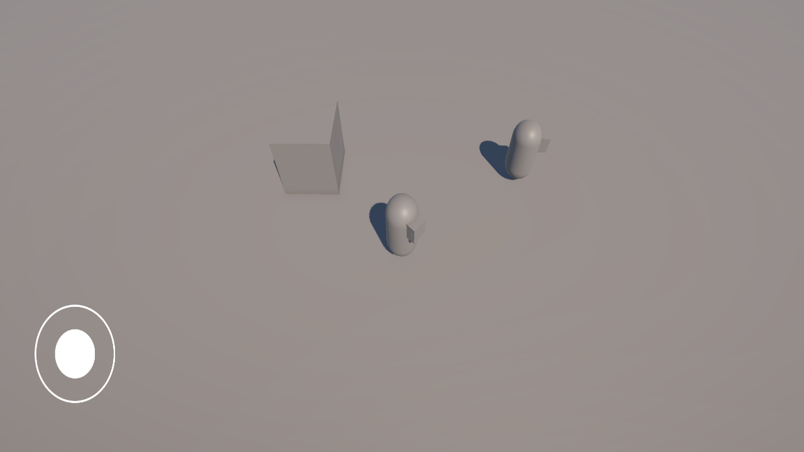
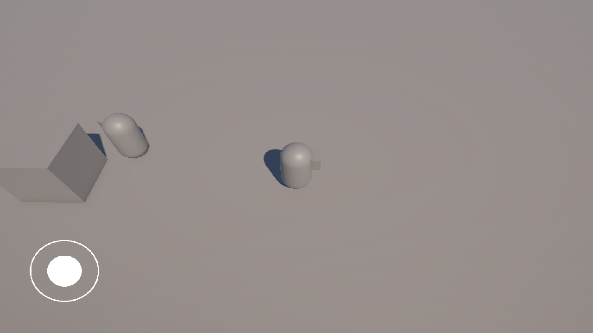

# 역할별 시작 씬과 로컬 멀티플레이 테스트

작성일: 2026-11-16 (한국 시간)

## 에디터에서 서버와 클라이언트 한 개씩 실행하기

1. Unity 에디터 상단의 재생 시나리오에서 **Server And Client**를 선택하고 **▶**를 누른다.
2. 메인 에디터가 로컬 Python 로그인 서버를 켜고 게임 서버를 시작한다. 두 서버가 준비되면 **Player 2**가 로그인 화면을 연다. 클라이언트는 저장된 게스트 토큰으로 자동 접속한다. 처음 실행한 프로필은 새 게스트 계정을 만든다.
3. **■**를 누르면 게임 서버와 이번 실행에서 시작한 로그인 서버가 함께 종료된다. 다음에 **▶**를 누르면 새 서버 키와 포트를 사용하고 저장된 진행도를 불러온다.

계정과 진행 정보는 기존 로그인 서버의 `localServer/data/auth.sqlite3`를 사용한다. `LOCAL_SERVER_DB`로 별도 DB를 지정한 에디터는 그 경로를 사용한다. 서버 간 인증 키는 메인 에디터가 실행마다 생성해 Python 자식 프로세스와 공유한다. 가상 클라이언트는 맥북 내부에서 사용할 주소와 포트만 전달받는다. 아이폰용 서버를 따로 실행해 둬도 에디터 시나리오는 자체 포트를 사용한다.

### 2026-11-23 플레이 모드 검증

Unity 6000.3.10f1에서 실제 시나리오 자산을 선택해 메인 에디터와 가상 Player 2를 두 번 연속 재생·중지했다. 기존 게스트를 준비한 임시 DB로 첫 접속에서 37골드를 확인했다. 인벤토리 튜토리얼을 수행해 47골드와 검을 받은 뒤, 두 번째 재생에서 같은 게스트와 저장 버전 2가 복원됐다. 두 번 모두 클라이언트가 서버 키 없이 `WorldSession`에 입장했고, 중지한 뒤에 로그인 TCP 포트와 게임 UDP 포트를 다시 바인딩할 수 있었다. [두 번의 실행 측정값](verification/editor-scenario/play-mode.json)

별도 로그인 서버와 에디터용 로그인 서버를 같은 임시 DB에 연결한 검사에서도 진행도는 공유됐고, 한쪽의 키로 다른 쪽 내부 API에 접근하면 거절됐다. 에디터용 서버를 종료한 뒤 별도 서버는 계속 응답했다. 실제 CLI 자식 프로세스의 동적 포트·부모 파이프 종료 처리를 포함한 백엔드 테스트 24개가 통과했다. [서버 회귀 테스트](../localServer/test_gameplay.py)

검증 프로젝트의 초기 에셋 인덱싱 중 Unity QuickSearch 워커가 시나리오 속성을 읽으면서 내장 assertion 한 건을 기록했다. 두 번의 플레이는 로그인·저장·종료까지 완료됐다.

## 초기 Bootstrap 구현 기록

- 공통 시작 씬: `Assets/Scenes/Bootstrap.unity`.
- `MultiplayerBootstrap`이 Multiplayer Play Mode의 `CurrentPlayer.Tags`를 읽는다.
- `Server`: `Prototype` 로드 → 인증 컴포넌트 준비 → `StartServer()`.
- `Client`: `Login Scene` 로드 → 로그인 성공 후 기존 `LoginSession`이 게임 씬 이동·토큰 전달·접속을 수행한다.
- 태그가 없는 일반 클라이언트 실행은 로그인 씬으로 이동한다. `UNITY_SERVER` 빌드는 서버 경로를 사용한다.
- 태그는 대소문자를 구분하지 않으며 Server·Client를 동시에 지정하면 설정 오류로 중단한다.
- 서버 전용 빌드·모바일 실기기 경로는 이번 검증 대상이 아니다.

기존 `ServerAndTwoClients` 시나리오에 메인 `Server`, Player 2·Player 3 `Client` 태그와 Bootstrap 시작 씬을 연결했다. Scene List에는 Bootstrap, Login Scene, Prototype이 포함되어 있다. Bootstrap에서는 새 NetworkManager를 만들지 않고 게임 씬의 기존 NetworkManager를 사용한다.

## ServerAndTwoClients 실행 방법

1. 터미널에서 `localServer`의 `python3 server.py serve`로 로그인 백엔드를 실행한다.
2. 서로 다른 계정 두 개를 준비한다. 동일 계정의 동시 게임 접속은 거절된다.
3. 에디터 상단 Play 드롭다운에서 `ServerAndTwoClients`를 선택하고 Play를 누른다.
4. 메인은 자동으로 게임 서버가 된다. 추가 창 두 개는 로그인 화면에서 대기한다.
5. 각 클라이언트에서 로그인하면 게임 씬에 접속하고 자신의 카메라·조이스틱으로 조작한다. Start Server·Start Client 버튼을 따로 누를 필요 없다.
6. 메인 에디터에서 시나리오를 중지하면 테스트가 끝난다.

기본 로컬 주소는 로그인 HTTP `127.0.0.1:8080`, 게임 서버 `127.0.0.1:7777`이다. 이 구성은 개발 PC 한 대에서 실행하는 테스트용이다.

## 확인한 결과

환경: macOS, Unity 6000.3.10f1, NGO 2.14.0, Multiplayer Play Mode 2.0.2.

- Bootstrap 코드 컴파일: 오류 없음.
- 서버 메인: `Server` 태그, `Prototype`, IsServer=true, IsListening=true.
- 추가 창 두 개: `Client` 태그, 로그인 전 `Login Scene`, 실행 프레임 증가 확인.
- 기존 사용자 DB 대신 임시 SQLite DB와 임시 계정 bootstrap_a·bootstrap_b 사용.
- 각 창의 실제 TMP 입력 필드에 계정을 넣고 OnSubmit 호출 → HTTP 로그인 → 게임 서버 `/auth/me` 검증 → ClientId 1·2 접속 승인.
- 서버 계정 대응: 1=bootstrap_a, 2=bootstrap_b. 양쪽 모두 상태가 `플레이 준비 완료`로 전환됨.
- 두 클라이언트에서 카메라 target이 자신의 Player이고 조이스틱 참조가 해당 창의 조이스틱임을 확인.
- 조이스틱 PointerDown·Drag·PointerUp을 코드로 주입했다. 자동화 중 창 포커스가 바뀌므로 해당 Player의 포커스 검사 값만 일시적으로 true로 설정했다. 이동 RPC나 위치 자체를 직접 호출·변경하지 않았다. 실제 마우스/터치 입력 검증과는 구분한다.
- 첫 Player 조작 시 두 번째 Player는 정지했고, 두 번째 Player 조작 시 첫 Player는 정지했다.
- 최종 위치가 서버와 두 클라이언트에서 일치했다:

| 소유 ClientId | X | Y | Z |
|---|---:|---:|---:|
| 1 | 3.27157879 | 1.07999992 | -3.08978248 |
| 2 | 7.695352 | 1.07999992 | -0.2089247 |

- 최종 실행 중 세 인스턴스 Console 오류·경고 각각 0건.
- 화면 캡처에서 플레이어 두 개와 각 클라이언트의 조이스틱 표시 확인.
- 시나리오·임시 백엔드 종료, 검증용 강제 에디터 갱신 해제. 기존 `localServer/data/auth.sqlite3`는 변경하지 않았다.

초기 시나리오 설정에서 태그 등록 전에 할당한 값이 에디터에 의해 비워지는 문제가 있었다. 태그를 등록한 뒤 시나리오에 재할당하여 최종 실행에서 Server·Client 전달을 확인했다.

## 검증 범위 밖

실기기, 클라우드, 서버 전용 빌드, 실제 터치 조작, 고지연·끊김 환경, 장시간 부하는 검증하지 않았다. 인증 거절·재접속의 전체 회귀 테스트도 이번에는 수행하지 않았다. 현재 Prototype의 플레이어 시작 위치와 씬에 배치된 몬스터가 겹칠 수 있어, 실제 맵 설계 시 시작 지점을 따로 배치하는 작업은 남아 있다.
