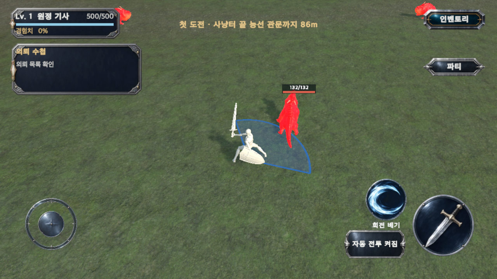

# 넷마블 네오 AI 인턴십 지원 게임 기획

작성일: 2026-11-13 · 최종 갱신일: 2026-11-24  
상태: 멀티플레이·서버 포함 반영 · 세부 범위·일정 재검토 필요 · 개별 승인한 로그인·이동·Bootstrap 구현 진행  
제출 목표: 2026-11-24 · 모든 일정은 한국 시간 기준

Unity로 Android와 iOS에서 플레이 가능한 소규모 게임을 싱글플레이와 멀티플레이·서버 구현을 포함하여 완성하고, 사용자가 AI와 협업하여 문제를 정의하고 결과를 검증하는 역량을 포트폴리오로 보여준다. 리니지2 레볼루션의 전투·성장·보스 도전 흐름을 참고하되, 짧고 완결된 수동 전투 경험에 집중한다.

이 문서는 제작을 시작하라는 지시가 아니다. 아래 일정과 완료 기준은 계획이며, 실제 완료 기록과 구분한다. 협업과 승인 절차는 [AGENTS.md](../AGENTS.md)를 따른다.

게스트 자동 로그인과 사냥 진행 저장·복원의 후속 구현 항목은 [프로젝트 할 일 리스트](TODO.md)에 정리했다.

## 1. 목표와 개발 원칙

| 항목 | 합의 내용 |
|---|---|
| 게임 이름 | 용이 잠든 능선 |
| 최종 목적 | 2026 넷마블 네오 AI 인턴십 지원용 포트폴리오 |
| 핵심 결과 | 실제 플레이 가능한 모바일 게임과 AI 협업 과정의 증거 |
| 첫 개발 목표 | 핵심 플레이 검증용 프로토타입 |
| 참조 게임 | 넷마블 네오의 리니지2 레볼루션, 현재 한국 서비스 기준 분석 |
| 게임 방향 | 판타지 배경의 3D 쿼터뷰 액션 RPG, 싱글플레이와 멀티플레이 포함 |
| 엔진과 플랫폼 | Unity, Android 및 iOS, 가로 화면 |
| 그래픽 | 저사양 지향, 단순한 자산과 효과로 판타지 분위기·전투 가독성 구현 |
| 조작 | 수동 전투가 기본이며 사냥터·보스방에서 자동 전투를 켤 수 있다. |
| 멀티플레이·서버 | 솔로 또는 최대 4인 파티의 보스 도전. 서버 전체 동시 접속 인원과 대전 범위는 별도 검토 |
| 분량 | 최초 완료까지 약 10~15분을 목표로 하는 짧은 완결형 플레이 |
| 자원 제약 | 사용자 1명과 AI 협업, 제한된 작업 시간과 토큰 |

원작은 다수의 사용자가 함께하는 MMORPG다. 이번 게임은 그중 전투와 성장 흐름을 선택한 축소 프로젝트이며, 혈맹·공성전·대규모 경쟁 경험까지 재현하는 것을 목표로 하지 않는다. 원작의 고해상도 표현이나 자산을 복제하지 않고 독립적인 이름과 자산을 사용한다.

사용자는 기획·프로그래밍과 최종 판단을 담당하고 AI는 이에 협업한다. 아트·애니메이션·이펙트·사운드는 AI가 제안과 실행을 주도하되, 사용자 검토와 제작 승인 절차를 동일하게 적용한다.

## 2. 필수 콘텐츠 범위

플레이 흐름은 **이동·전투 안내 → 일반 적 사냥 → 성장·장비 교체 → 보스 도전 → 완료 화면**이다. 실패하면 재도전할 수 있고, 저장 후 다시 실행해 진행을 이어갈 수 있어야 한다.

| 콘텐츠 | 필수 구현 범위 |
|---|---|
| 플레이어 | 외형 고정 근접 캐릭터 1종 |
| 맵 | 마을·일반 사냥 필드·보스방 3개 씬. 필드 안에서 드래곤 4구역과 멧돼지 1구역을 자유롭게 이동. 씬 제작 및 배치 검증과 실제 서버 연결은 별도 범위. [씬 배치와 검증](WORLD_MAPS.md) |
| 일반 적 | 영혼 포식자 드래곤 4종과 용비늘 멧돼지 2종. 황금 멧돼지는 일반 멧돼지와 전투 성능을 공유 |
| 필드 몬스터 행동 | 용비늘 멧돼지는 구역 안에서 배회하고 영혼 포식자는 잠든 채 시작한다. 최초 조우 때 포효한 뒤 추격·근접 공격하며, 탐지 거리 또는 사냥 구역을 벗어나면 스폰 지점으로 복귀한다. 복귀 중 구역 안에서 플레이어에게 맞으면 해당 플레이어와 다시 전투한다. 두 필드 몬스터의 공격은 모션으로 예고한다. |
| 보스 | 1종, 기본 공격과 사전에 위험 범위를 보여주는 범위 공격 |
| 플레이어 공격 | 일반 공격, 강한 단일 공격 스킬, 범위 공격 스킬 |
| 성장 | 레벨 1~20, 경험치 획득과 능력치 상승 |
| 장비 | 검·투구·방어구, 슬롯별 3종. 일반·레어·전설, 2·3부위 세트 효과와 등급별 강화 상한 +5/+6/+7. 보스 퀘스트의 전설 종결 검은 모든 세트에 대응하며 강화 실패 시 단계 하락은 가능하고 파괴는 면제 |
| 회복 | 사용 횟수가 제한된 회복 수단, 재도전 시 보충 |
| 목표 안내 | 의뢰 수첩·HUD로 목표를 안내한다. 자동 진행을 켜면 의뢰 수행과 레벨업 사냥을 거쳐 최종 보스 관문 앞에서 멈춘다. [의뢰 목록과 진행 방식](QUEST_STORY_FLOW.md) |
| 종료와 재도전 | 보스 처치 시 퀘스트 목표 달성, 이후 퀘스트 보상으로 재화·강화 재료·종결 검 지급. 승리 후 마을 복귀. 완료자도 종결 검을 해제하면 다시 도전 가능 |
| 표현 | 이동·공격·피격·사망을 구분할 최소 애니메이션, 적중·위험 예고 효과와 소리 |

새로운 직업, 복잡한 콤보, 별도의 회피 버튼은 필수 범위에 넣지 않는다. 전투 피드백의 최소 표현은 필수이며, 여유 시에는 그 품질을 개선한다.

## 3. 필수 시스템 범위

| 시스템 | 구현 기준 |
|---|---|
| 모바일 입력 | 왼쪽 가상 조이스틱, 오른쪽 공격·스킬·회복 버튼, 이동과 공격의 동시 터치 |
| 카메라 | 플레이를 읽기 쉬운 3D 쿼터뷰 추적 카메라 |
| 공격 대상 선택 | 버튼 입력 시 거리와 방향을 기준으로 유효한 대상을 선택 |
| 전투 규칙 | 공격 범위, 피해, 체력, 쿨타임, 사망 처리 |
| 적 행동 | 감지·추적·공격·복귀, 보스 위험 범위 예고 |
| 성장·장비 | 경험치, 레벨 상승, 장비 획득·비교·착용, 효과 적용 |
| 인벤토리 | 작은 목록 기반 장비 관리, 드래그 조작·창고 제외 |
| 진행 관리 | 현재 목표, 보스 보상 중복 지급 방지, 실패·완료 상태 |
| 로컬 저장 | 레벨·경험치·장비 및 소지품·목표 진행을 안전한 체크포인트에서 저장. 서버 저장과의 역할·연계는 추후 검토 |
| 멀티플레이 | 필드에서 다른 플레이어를 눌러 최대 4인 파티에 초대. 솔로·파티가 시작한 도전마다 독립된 보스방을 사용 |
| 서버 | 이번 제출에 구현 포함. 서버의 책임, 기술, 실행·배포 환경과 저장 범위는 추후 검토 |
| 로컬 로그인 백엔드 | `localServer`에서 아이디·비밀번호 로그인 구현 승인. Python·SQLite로 로컬 테스트하며 회원가입 API·계정 생성 명령·토큰 인증 제공. 개별 승인한 Unity 가입·자동 로그인·NGO 접속 인증 연결. 클라우드 배포는 별도 검토 |
| 화면 흐름 | 시작·이어하기·새 게임·일시정지·완료, 음량 조절 |
| 모바일 대응 | 화면 비율·안전 영역, 백그라운드 전환과 복귀 시 입력 해제 및 상태 처리 |

입력, 전투 규칙, 화면 표현, 저장의 책임을 나누고 캐릭터·아이템 등에 안정적인 식별자를 사용한다. 보상 지급 경로를 모으고 저장 데이터 버전을 구분하여 향후 변경에 대비한다. 멀티플레이·서버 구현에서도 이 책임 분리를 기준으로 설계한다. 이는 설계 원칙이며, 서버 연결이나 동기화가 이미 구현된 것을 뜻하지 않는다.

파티장이 보스 도전을 시작하면 파티원이 각자 수락한다. 입장 시 보스 의뢰를 보유했던 참가자는 전투 중 사망하거나 접속을 종료해도 동료가 보스를 처치하면 보고할 수 있다. 경비대장에게 보고한 계정은 100골드, 강화석 10개, 정제 강화석 1개와 전설 +0 잠든 용의 검을 한 번 받는다. 검은 각 세트에 한 부위로 계산하며, 강화에서 파괴 판정이 나오면 한 단계 하락한다. 보스방에 들어갈 때 검을 해제해야 하며 전장 안에서도 착용할 수 없다. 서버 전체 동시 접속 인원과 대전 포함 여부는 별도로 정한다. [파티 도전과 보상 결정](TODO.md#todo-023--솔로파티-전용-보스방과-클리어-퀘스트-보상)

11월 20일 보스 전투는 기본 근접 공격, 직사각형 발톱 공격, 지상·공중 부채꼴 화염, 고정 피해 반사로 구체화했다. 화염은 실제 피해를 준 틱마다 명중 인원에 관계없이 최대 체력의 3%를 회복한다. 보스 체력 75·50·25%에서 방어력이 한 번씩 낮아지고, 공중에서는 공격을 회피한다. 네트워크 전투 판정과 별도로 플레이어·몬스터의 체력바와 숫자가 직전 표시값에서 새 값까지 이어진다. [패턴과 체력 표시](BOSS_PROTOTYPE.md)

다인 파티 보스전에서 쓰러지면 전장에 남아 생존한 동료를 관전한다. ‘다음 파티원’으로 관전 대상을 바꿀 수 있고, 대상이 쓰러지거나 전장을 떠나면 다음 생존자를 자동으로 따라간다. 파티가 보스를 처치하거나 전멸하면 사망자는 부활해 전원 함께 야영지로 돌아간다. 솔로 보스와 일반 필드에서는 사망 2.5초 뒤에 야영지에서 부활한다. [파티 보스 관전](BOSS_PROTOTYPE.md#파티-보스-관전)

마을의 경비대장은 착용하지 않은 사냥 장비를 일반 30골드, 레어 100골드, 전설 300골드에 매입한다. 마을에서 다른 기사를 선택하면 양쪽이 사냥 장비·강화석·정제 강화석·골드를 제안할 수 있다. 양쪽이 동일한 제안을 확정하면 거래가 성립하며, 물품이 바뀌면 다시 확인한다. [장비 판매와 교환 저장 규칙](../localServer/README.md#장비-판매와-플레이어-교환)

## 4. 이번 제출에서 제외하는 범위

- 채팅, 혈맹, 공성전. 로그인·계정은 로컬 테스트용 회원가입·아이디·비밀번호 인증과 게임 서버 토큰 인증을 포함한다. 인터넷 공개 운영, 계정 복구, 외부 계정 연동은 제외한다.
- PvP 포함 여부는 협동·대전 방식 검토 시 결정한다. 현재 필수 기능으로 확정하지 않는다.
- 신규 직업·전직, 대규모 필드, 추가 지역, 여러 던전과 보스.
- 제작, 상품 구매 상점·다중 재화, 펫·탈것·도감, 일일 과제.
- 광고·인앱 결제, 앱스토어 출시, TestFlight 배포 운영.
- 전반적인 자동 장비 관리. 자동 진행의 검 장착 튜토리얼은 보급받은 검을 착용한다.
- 제출을 위한 별도 웹 빌드. 게임 확인 자료는 영상 중심으로 준비한다.

## 5. 완료 기준과 모바일 빌드

iOS·Android의 일반·Development Build는 집 서버의 DDNS 이름 `binaryRight.iptime.org`를 사용한다. 로그인은 HTTP 8080/TCP, 게임은 7777/UDP로 접속한다. 변경된 주소는 Unity에서 새로 빌드해 설치할 때 적용한다. [모바일 빌드와 포트포워딩](LAN_IPHONE_SETUP.md)

기존 싱글플레이·모바일 필수 완료 기준은 다음과 같다. 멀티플레이·서버의 완료 기준과 검증 시나리오는 세부 범위 확정 시 추가하며, 아래 기준만으로 확대된 제출 범위의 완료를 판단하지 않는다.

1. Android와 iPhone 실기기에서 실행하여 시작부터 보스 처치·완료까지 진행한다.
2. 이동과 공격을 동시에 입력할 수 있고, 손을 떼거나 앱을 복귀했을 때 입력이 고착되지 않는다.
3. 적의 공격 예고, 적중, 피격, 사망이 구분된다.
4. 레벨 상승과 장비 교체가 전투 결과에 반영된다.
5. 저장 후 재실행해 진행을 이어가며, 보스 보상이 중복 지급되지 않는다.
6. 정한 테스트 기기에서 30fps를 성능 목표로 삼고 실제 측정 결과를 기록한다. 측정하지 않은 모든 저사양 기기의 성능을 보장한다고 표현하지 않는다.
7. 최종 영상·문서에 표시한 기능과 제출 기준 빌드가 일치한다.

Android는 내부 확인용 APK, iOS는 Xcode를 통한 실기기 설치를 기본 계획으로 한다. iOS는 Mac·Xcode·서명과 기기 연결 확인이 필요하다. 무료 Personal Team 사용 시 프로비저닝 유효기간에 맞춘 재설치가 필요하므로 최종 검증 시 설치 상태를 다시 확인한다. 스토어 배포는 목표가 아니다.

플랫폼마다 기기 모델, OS, 빌드 식별자, 검증 일시와 결과를 남긴다. 실제 기기 검증을 하지 못했다면 지원 완료로 기록하지 않는다.

### 모바일 앱 아이콘

로그인 일러스트에서 사용자가 고른 남자 기사를 중심에 배치했다. 내장 이미지 생성 도구(ImageGen)로 원본 기사의 얼굴과 금장 갑옷, 붉은 망토를 아이콘용으로 확대해 다시 그리고, 로그인 배경의 구름과 하늘을 합성했다. [로그인 기사 원본](../NetmarbleNeo/Assets/Art/AI%20Generated/LoginKnight.png) · [완성 아이콘](../NetmarbleNeo/Assets/Art/AI%20Generated/MobileKnightIcon.png)

iOS는 1024 × 1024 불투명 PNG를 사용한다. Android 적응형 아이콘은 투명한 기사 전경과 불투명한 하늘 배경을 따로 두어 런처가 모양을 바꿔도 얼굴이 중앙에 남게 했다. [홈 화면 크기와 마스크 미리보기](verification/mobile-app-icon.png)

2026-11-23 Unity 에디터에서 iOS 19개와 Android 18개 아이콘 슬롯을 다시 읽고 저장된 프로젝트 설정과 대조했다. 120·64·48px 미리보기에서 얼굴과 어깨 갑옷을 확인했다. 실기기 홈 화면 확인은 다음 모바일 빌드 설치 후 진행할 항목이다.

기사 전경 제작에 사용한 프롬프트

Use case: identity-preserve. Make a single character foreground layer for the official mobile app icon of a Korean dark high-fantasy RPG. Edit target image 1 is the exact male knight from our login painting, isolated. Image 2 is his source scene and the original light/style reference. Reframe and restore detail in a tight head-and-shoulders crop of precisely this same unhelmeted man. Preserve his clean-shaven realistic handsome angular face, wavy swept chestnut hair, and the confident upward gaze toward the viewer's left in three-quarter profile. Preserve his distinctive burnished gunmetal plate shoulder with antique gold foliage on viewer left, high engraved gorget and burgundy red cape on viewer right. Square 1:1 app icon foreground ONLY, on a true transparent background. Compose his head big near center, top of hair about 9% from top, eyes at 42% height, chin at 63% height, face and hair together about 53% canvas width (from ear to front). Leave a small amount of breathing room above hair, shoulders naturally extending off the sides and bottom in full bleed. No bald display bust, no closed-off bottom or side at shoulders. Only head and shoulders, no sword or hands in frame. Render the original fantasy key art's warm directional sunlight from upper left, readable warm skin against dark hair, strong clear shapes on ornate armor, natural painterly texture. No other figures, no sky, text, logo, decorative badge, border, frame, or drop shadow. Do not darken the face. True alpha around hair and silhouette.

## 6. 날짜별 개발 일정

**재검토 필요:** 아래 일정과 시간 배분은 기존 싱글플레이 범위 기준이다. 2026-11-14 추가한 멀티플레이·서버 구현·통합·검증 시간은 아직 반영하지 않았다. 세부 범위와 실제 잔여 시간을 확인한 뒤 사용자 검토를 거쳐 일정을 조정한다. 제출 목표와 기능 동결·실기기 검증·자료 정리·예비·제출 준비 일정은 유지하며, 현재 시간 내 확대 범위의 실현 가능성이 검증된 것은 아니다.

화·수·목은 하루 3시간, 나머지 요일은 하루 6시간이다. 2026년 11월 13일부터 24일까지 총 **60시간**이며, 기획·사용자 검토·AI 협업·빌드·검증·증거 정리도 이 시간에 포함한다. 매 작업일 15~20분 정도의 증거 정리 시간을 해당 일 예산 안에 포함한다.

첫날 6시간을 온전히 사용할 수 있다는 계획이다. 이미 소요한 기획 시간과 실제 잔여 시간을 확인한 뒤 조정하며, 승인 대기나 도구 준비에 쓴 시간을 개발 시간 외부로 숨기지 않는다.

| 날짜 | 요일 | 시간 | 작업과 확인할 결과 |
|---|---|---:|---|
| 11/13 | 금 | 6시간 | 범위·조작·시각 방향 검토, 기기·Unity·Xcode 준비 확인. 제작 승인 이후의 첫 목표는 최소 장면의 양 플랫폼 실기기 실행 |
| 11/14 | 토 | 6시간 | 맵·카메라·터치 이동·일반 공격·적 1종, 모바일에서 전투 시작 가능 |
| 11/15 | 일 | 6시간 | 적 2종째·스킬·체력·사망·회복·재도전, 기본 전투 한 사이클 확인 |
| 11/16 | 월 | 6시간 | 경험치·장비·저장, 성장과 재실행 후 복원 확인 |
| 11/17 | 화 | 3시간 | 보스와 범위 공격 예고, 공격을 보고 대응할 수 있는지 확인 |
| 11/18 | 수 | 3시간 | 보스 보상·완료 화면·목표 연결, 최초 전체 플레이 완주 |
| 11/19 | 목 | 3시간 | 모바일 UI·안전 영역·동시 터치·앱 복귀, 양 플랫폼 중간 확인 |
| 11/20 | 금 | 6시간 | 시각·이펙트·소리·밸런스 정리, 기능·콘텐츠 동결 및 검증용 후보 빌드 |
| 11/21 | 토 | 6시간 | 양 플랫폼 전체 플레이, 저장·복귀·성능 검증과 결함 수정 |
| 11/22 | 일 | 6시간 | 영상·포트폴리오 문서·AI 대표 사례와 증거 정리 |
| 11/23 | 월 | 6시간 | 보호된 예비 시간, 잔여 결함·제출물 수정, 최종 빌드와 링크 확인 |
| 11/24 | 화 | 3시간 | 지원서·기여도·제출 링크 최종 확인, 사용자 제출 목표 18:00 |
| 합계 | | **60시간** | 공식 공고에서 확인한 마감은 11/24 23:59이며, 마지막 시각까지 작업하지 않는 계획 |

배분은 11/13~20 기획·제작 39시간, 11/21 검증 6시간, 11/22 자료 정리 6시간, 11/23 예비 6시간, 11/24 제출 준비 3시간이다. 예비 시간을 추가 기능 개발에 선배정하지 않는다. 지원서 제출 행위는 사용자가 진행한다.

## 7. 지연 시 축소 순서

축소는 사용자 검토 후 적용한다. 남은 시간을 고려해 여러 단계를 함께 줄일 수 있다. 아래 순서는 기존 싱글플레이 기준이며, 멀티플레이·서버의 축소 기준과 우선순위는 세부 범위·일정 검토 때 함께 정한다.

| 순서 | 축소 대상 | 축소안 |
|---|---|---|
| 1 | 장식과 연출 | 배경 장식·추가 이펙트·배경음악 축소, 위험 예고와 필수 전투 피드백 유지 |
| 2 | 장비 분량 | 3단계에서 2단계로 축소, 아이콘·설명 수 감소 |
| 3 | 인벤토리 UI | 목록 관리 대신 획득 시 비교·착용 패널로 단순화, 착용 장비 저장 유지 |
| 4 | 일반 적 종류 | 2종에서 1종으로 축소 |
| 5 | 스킬 수 | 액티브 스킬 2개에서 1개로 축소 |
| 6 | 플레이 길이 | 목표와 사냥량을 줄여 10~15분에서 5~8분으로 축소 |

양 플랫폼 실기기 검증, 수동 조작, 성장·저장의 기본 흐름, 시작부터 완료까지의 연결, 실제 플레이 영상과 AI 협업 증거는 우선 보호한다.

| 판단 시점 | 미달 상태 | 검토할 대응 |
|---|---|---|
| 11/16 | 성장·저장이 연결되지 않음 | 장비 수와 인벤토리 UI 축소 |
| 11/18 | 전체 플레이를 완료할 수 없음 | 적 종류·스킬 수·플레이 길이 축소 |
| 11/20 | 미완성 또는 불안정 기능 존재 | 신규 기능 중단, 필수 흐름과 결함 수정에 집중 |
| 어느 시점이든 | 플랫폼 빌드·설치 실패 | 원인 확인과 해결을 우선하고 필요하면 예비 시간을 앞당겨 사용, 실제 검증 상태를 정확히 기록 |

## 8. 여유 시 추가 우선순위

추가 기능은 자동으로 승인되지 않는다. 멀티플레이·서버는 여유 시 추가 후보가 아니라 이번 제출 범위이며, 해당 구현·통합·검증 시간을 반영한 일정 재검토 후에 아래 후보의 여유 시간을 판단한다. 양 플랫폼에서 전체 플레이가 동작하고 조작·저장·보상에 진행을 막는 문제가 없어야 한다. 11/21 검증, 11/22 자료 정리, 11/23 예비 시간을 확보한 상태에서 **11/20 기능 동결 전에 통합과 기본 확인을 끝낼 수 있을 때만** 사용자와 검토한다.

아래 시간은 기존 시스템 재사용과 해당 변경의 기본 확인을 전제로 한 추정치다. 모든 후보를 합산하여 구현하기로 한 것이 아니다.

| 우선순위 | 추가 후보 | 최소 범위 | 예상 시간 | 보여줄 가치 |
|---|---|---|---|---|
| 1 | 전투 피드백 개선 | 적중 효과·소리, 피격 반응, 버튼 사용 가능 상태의 가독성 개선 | 2~4시간 | 동일 전투의 조작성·가독성 전후 비교 |
| 2 | 보스 패턴 1개 추가 | 직선 공격 또는 체력에 따른 공격 순서 변화 | 3~5시간 | 관찰과 대응이 필요한 수동 전투 설계 |
| 3 | 장비 선택의 차이 | 같은 외형으로 일반 공격 강화형과 스킬 쿨타임 감소형 중 선택 | 4~6시간 | 선택의 의미와 밸런스 검증 |
| 4 | 도전 모드 | 동일 맵·적을 재사용하고 배치·수치·보상을 조정한 난이도 1개 | 4~6시간 | 제한된 자산으로 재플레이 가치 확보 |
| 5 | 간단한 자동 전투 (11월 22일 승인) | 켜기·끄기, 주변 적 탐색·접근·일반 공격 | 6~10시간 | 수동 입력과 자동 판단에서 같은 전투 규칙 재사용 |

가장 권장하는 조합은 전투 피드백 개선과 보스 패턴 추가다. 장비 선택은 저장·UI·효과 적용까지 안정적일 때 검토한다. 자동 전투의 승인 범위와 검증 기록은 [자동 전투](#자동-전투)에 정리한다.

| 실제 여유 시간 | 선택 기준 |
|---|---|
| 2~3시간 | 가장 부족한 전투 피드백 한 가지 개선 |
| 4~6시간 | 보스 패턴 또는 전투 피드백 개선 중 하나 |
| 7~10시간 | 전투 피드백 개선과 보스 패턴 추가 |
| 10시간 초과 | 위 조합 검증 후 장비 선택 또는 도전 모드 중 하나 검토 |

실제 반복 문제가 생긴다면 게임 기능 대신 **작은 데이터 검증 도구**를 2~4시간 규모로 검토할 수 있다. 스킬 효과 참조 누락, 음수 쿨타임, 아이템 ID 중복 등을 검사하는 도구다. 필요가 확인될 때만 만들고 별도 대형 도구로 확장하지 않는다. 검증용 오류를 의도적으로 넣었다면 그 사실을 기록한다.

신규 직업·지역, 제작·강화 시스템은 여유 시간으로 추가하지 않는다. 남는 시간의 일부는 개선 전후 영상과 증거 정리에 사용한다.

## 9. AI 활용 대표 사례와 증거

아래는 앞으로 수행하고 검증할 사례 후보이며, 이미 달성한 성과가 아니다. 게임 내 적 행동 AI와 제작 과정에서 활용하는 생성형 AI의 역할을 구분해 설명한다.

| 대표 사례 | 사용자 역할 | AI 역할 | 남길 증거 |
|---|---|---|---|
| 원작 분석에서 모바일 범위 결정까지 | 핵심 경험·우선순위·제외 이유 결정 | 자료 분석, 문제 분해, 대안·구현안 제안 | 참조 요소 대응표, 범위 변경 이유, 초기·최종 플레이 흐름 |
| 보스 전투와 터치 조작 개선 | 문제 재현, 평가 기준, 결과 검토와 선택 | 위험 예고·입력·UI·코드 개선안 제안 및 승인된 수정 | 같은 조건의 전후 영상, 재현 절차, 핵심 요청·수정 이력, 재검증 결과 |
| 저사양 아트·이펙트 통합 | 시각 방향과 성능 기준 결정, 결과 선택 | 자산·효과 제작 및 최적화 방안 | 스타일 기준, 후보 비교, 사용 도구·기여 구분, 기기별 실제 측정 |

증거는 매 작업일 다음 형식으로 짧게 정리한다. 전체 대화 덤프보다 판단과 개선이 드러나는 사례를 선별한다.

- 날짜, 해결하려는 문제, 완료 판단 기준.
- 사용한 AI 도구와 맡긴 작업, 핵심 요청과 수정 요청.
- 사용자가 수락·수정·거절한 내용과 이유.
- 변경 전후 화면·영상·코드 또는 데이터 비교.
- 실제 빌드 식별자와 파일 위치, 버전 관리 도입 후에는 관련 커밋.
- 테스트 기기·조건·측정 결과, 남은 문제.
- 사용자·AI·외부 자산의 기여와 출처 구분.

작업 시간 절감이나 성능 향상 수치를 추정으로 성과처럼 쓰지 않는다. 비교 조건과 실제 측정이 있어야 수치를 제시한다. AI가 만든 결과를 사용자가 어떻게 검토하고 수정했는지를 대표 사례에 포함한다.

## 10. 최종 산출물과 제출 준비

| 산출물 | 목적과 범위 |
|---|---|
| Android·iOS 플레이 가능 빌드 | 내부 실행·검증용, 기기별 설치와 전체 플레이 확인 |
| Unity 프로젝트와 실행 안내 | 결과 재현, 빌드 환경과 알려진 제한 정리 |
| 서버 구현과 실행 안내 | 서버 코드·필요 설정·실행 방법, 구체적인 기술과 배포 방식은 추후 검토 |
| 멀티플레이·서버 검증 증거 | 확정한 인원·플레이 방식에 따른 접속·동기화 및 서버 동작의 실제 검증 기록, 세부 기준은 추후 검토 |
| 포트폴리오 문서 | 약 8~10쪽 권장, 목표·범위·본인 기여·AI 사례·검증 결과 |
| 플레이 영상 | 약 2~3분 권장, 실제 수동 전투·성장·보스·완료 흐름 |
| 양 플랫폼 실행 증거 | 실제 기기·OS·빌드와 실행 기록 |
| AI 협업 증거 | 대표 사례 3개 중심의 요청·선택·수정·검증 자료 |

페이지 수와 영상 길이는 프로젝트 권장안이며 공식 제출 규격으로 확정된 값이 아니다. 기존에 확인한 공고에서는 실행 파일 제출을 받지 않고 영상 또는 웹 링크로 확인하도록 안내했다. 공유 드라이브 이용 시 Google Drive를 사용하고 로그인 없이 읽을 수 있도록 준비한다. 모바일 실행 패키지 완성과 채용 시스템에 제출하는 파일 형식은 구분한다.

최종 제출 전에는 실제 지원 화면의 형식·용량·링크 조건을 확인한다. 외부 링크 공개와 제출은 해당 단계에서 사용자와 검토한다.

## 11. 제작 전 확인할 사항

- Android와 iPhone의 모델·OS, 실기기 사용 가능 여부.
- Unity와 Android 빌드 도구, Mac·Xcode·iOS 서명 환경 준비 상태.
- 사용할 Unity 버전과 구체적인 시각 스타일. 저사양 판타지 방향 이외의 세부 사항은 미확정.
- 현재 실제 남은 작업 시간과 기획·환경 준비에 이미 사용한 시간.
- 멀티플레이 동시 인원·협동/대전 방식·동기화 대상, 서버 기술·책임·실행/배포 환경과 저장·인증 범위.
- 멀티플레이·서버 완료 기준과 검증 시나리오, 확대 범위를 반영한 일정·축소 기준.
- 위 조건에 맞춘 일정 조정 및 사용자의 명시적인 게임 제작 진행 지시.

`localServer`의 로컬 로그인 백엔드와 개별 지시한 Unity 로그인·이동·Bootstrap 작업이 승인되었다. 2026-11-16 Bootstrap 역할별 시작과 두 클라이언트 로그인·이동 동기화의 에디터 실행 확인은 [검증 기록](BOOTSTRAP_TEST.md)에 남겼으며, 전체 게임 제작·실기기 검증 완료를 의미하지 않는다. 그 외 설치·프로젝트 생성·게임 코드·자산 제작·빌드는 별도 승인 전 수행하지 않는다. 준비 상태가 확인되지 않은 항목을 완료한 것으로 기록하지 않는다. 로컬 서버 실행·API 안내는 [localServer/README.md](../localServer/README.md)에 기록한다.

## 12. 참고 자료와 합의 이력

아래는 앞선 분석에서 사용한 공식 자료다. 원작 전체 기능을 이번 필수 범위로 간주하지 않는다.

- [리니지2 레볼루션 공식 가이드](https://guide.netmarble.com/lineageII)
- [넷마블 네오 2026 AI 인턴십 안내](https://ai-internship2026.netmarbleneo.com/)
- [넷마블 채용 공고](https://career.netmarble.com/announce/view?anno_id=1899)
- [인턴십 지원 가이드](https://ai-internship2026.netmarbleneo.com/guide)
- [Unity iOS 개발 환경 안내](https://docs.unity3d.com/cn/6000.0/Manual/ios-environment-setup.html)
- [Apple 개발자 계정 안내](https://developer.apple.com/help/account/basics/about-your-developer-account)

| 날짜 | 합의 |
|---|---|
| 2026-11-13 | 참조 게임·Unity·저사양·싱글플레이·수동 전투 우선 및 향후 서버 확장 고려 |
| 2026-11-13 | 인턴십 포트폴리오 목적, Android·iOS, 11/24 제출과 요일별 시간 예산 |
| 2026-11-13 | 필수 범위·날짜별 일정·지연 시 축소·여유 시 추가 우선순위 정리 |
| 2026-11-13 | 기획 문서 작성과 AGENTS.md 갱신 승인, 게임 제작은 계속 보류 |
| 2026-11-14 | 싱글플레이에 더해 멀티플레이·서버 구현을 이번 제출 범위에 포함하도록 문서 변경 승인. 세부 방식·기술·검증 기준은 미정이며 기존 일정은 재검토 필요. 게임 제작 보류 유지 |
| 2026-11-14 | 추가 질문 없이 `localServer` 아래 아이디·비밀번호 로컬 로그인 백엔드 구현 진행 승인. 이 작업에 한정된 예외이며 나머지 제작 승인 절차는 유지 |
| 2026-11-16 | Bootstrap 공통 씬에서 Server·Client 태그별 시작 씬 분기 구현 및 실행 검증 승인. 서버 1개·클라이언트 2개의 로그인·접속·이동 동기화 확인, 범위·제약은 BOOTSTRAP_TEST.md에 기록 |

| 2026-11-16 | Unity 회원가입·DB 저장·자동 로그인·게임 접속 구현 및 검증 승인. 두 클라이언트 신규 가입과 오류·재시도 결과는 [SIGNUP_TEST.md](SIGNUP_TEST.md)에 기록 |
| 2026-11-17 | Player 위치·회전 동기화를 서버 권한 NetworkTransform으로 전환하고 Dummy Monster에 서버 측 무작위 이동(3~5초 정지/3~5초 이동) 코드·프리팹 설정 추가. 입력 RPC와 서버 이동 계산 유지. 플레이 실행 검증은 사용자 요청에 따라 미수행. 몬스터는 추적·길찾기·이동 구역 제한 없이 이동하므로 바닥 끝으로 나갈 수 있음 |
| 2026-11-17 | 이동·피격에서 Rigidbody를 사용하지 않는 방향 승인. Player·몬스터 CharacterController 이동, 서버 체력 100·피해 10·공격 간격 1초·거리 2.5·전방 120도 범위 판정, 기존 공격 버튼 연결 및 체력 목록 UI 구현. 플레이 실행 검증 미수행. 상세는 [COMBAT_PROTOTYPE.md](COMBAT_PROTOTYPE.md) |
| 2026-11-17 | Player Test 모델·Player Animator의 이동 상태와 3타 콤보 연결 승인 및 구현. 서버에서 콤보·타격·이동 제한을 판정하고 클라이언트에 상태 전달. 플레이 검증 미수행. 설정은 [PLAYER_ANIMATION.md](PLAYER_ANIMATION.md) |
| 2026-11-17 | 콤보 공격 버튼의 시간 제한 비활성화 제거. 1·2타 전체에서 다음 타 한 번 예약, 소유 클라이언트에 확정 단계 숫자 로그 추가. 실행 검증 미수행 |
| 2026-11-17 | 동일 Wi-Fi iPhone 테스트용 LAN 설정 적용: Mac 192.168.201.12, 로그인 8080/TCP, 게임 7777/UDP, 서버 listen 0.0.0.0, 개발용 HTTP·iOS 권한 빌드 후처리 추가. 방화벽 확인만 수행. 빌드·서버 실행·실기기 연결 미수행. [실행 안내](LAN_IPHONE_SETUP.md) |
| 2026-11-17 | Unity 및 현재 ClientBuild에 가로 두 방향만 허용하도록 설정. 루트 start-servers.command에 로그인·게임 서버 동시 실행, 포트 중복 확인, 로그 분리 및 함께 종료 구현. 실행·빌드 검증 미수행 |

| 2026-11-17 | 포크 채팅에서 근접 몬스터 감지·추적·공격·복귀 AI 구현. 서버에서 타격 판정, 상태 동기화 및 체력 목록 상태 표시. 부활·리스폰 제외. [MONSTER_AI.md](MONSTER_AI.md) 참조 |
| 2026-11-17 | Blender 설치 후 원본 저폴리 고블린 모델·리깅·걷기·도끼 공격 모션 제작 승인 및 제작. 별도 Unity 미리보기 프리팹과 FBX, 렌더 미리보기 제공. 자산 구조와 임포트 확인, 게임 로직 연결·실기기 검증 제외. [GOBLIN_ASSET.md](GOBLIN_ASSET.md) 참조 |
| 2026-11-17 | 사용자 피드백에 따라 고블린 모델링만 재제작. 리깅·애니메이션 제외, 얼굴·체형·장비 형태 개선용 정적 V2 원본·FBX·GLB·렌더 제공. 기존 게임 자산 교체와 모바일 최적화 제외. [제작 기록](../ArtSource/GoblinV2/README.md) |
| 2026-11-17 | 드래곤 Sleep·최초 Scream·Run 추격·Basic Attack·Get Hit·Die 및 이탈 후 Idle/Walk 배회 구현 승인. 공격 중 피격 모션 취소 없음, 사망 후 서버 풀 반환, 자동 리스폰 제외. 프리팹·Animator·기존 스폰 지점 연결. 실행 검증 미수행. [DRAGON_MONSTER.md](DRAGON_MONSTER.md) |
| 2026-11-17 | 사용자 승인으로 유료 서비스 없이 드래곤 피격·사망·깨물기·최초 발견 포효 4종을 로컬 합성. 48kHz/16-bit/mono WAV와 미리듣기, 재현 코드 제공. 파일·음량 검사 완료, 청취 품질 판단·Unity 연결·플레이 검증 미수행. [제작 기록](../ArtSource/DragonSFX/README.md) |
| 2026-11-17 | 플레이어 파랑·드래곤 빨강 공격 범위 Decal 구현 승인. 판정 거리·각도를 직접 사용한 월드 좌표 마스크, PC/모바일 렌더러와 Prototype 표면 및 프리팹 연결. 플레이·렌더·실기기 검증 미수행. [ATTACK_RANGE_DECALS.md](ATTACK_RANGE_DECALS.md) |

### 2026-11-17 로컬 조작 테스트와 콤보 전환

사용자 승인으로 `Player Controll Test` 씬에 서버 없는 로컬 전투 모드를 추가했다. 기존 멀티플레이의 권한·동기화 경로와 로컬 상태를 구분하며, 이동·공격·피격 및 몬스터 AI 로직을 공유한다. 1·2타 입력 예약을 유지하고 마지막 0.4초에 다음 타로 전환하며 0.12초 블렌딩을 적용했다. 실행 검증은 하지 않았다. 사용법과 제한은 [로컬 테스트 안내](LOCAL_COMBAT_TEST.md)를 참조한다.

2026-11-17 후속 승인: 고정 0.4초 전환을 클립의 `ComboTransitionOpen`·`ComboInputClose` 이벤트 시간 기반으로 교체했다. 위치는 사용자가 지정한다. 서버·로컬에서 공통 시간을 판정하고 애니메이션 콜백은 수신만 한다. 실행 검증은 수행하지 않았다.

2026-11-18 성장 구간을 레벨 1~10으로 확정했다. 로그인 서버 SQLite에 계정별 성장·장비·목표 체크포인트를 저장한다. [성장 설계 및 API](../localServer/README.md#성장-체크포인트) 참조.

2026-11-18 후속 기획에서 최고 레벨을 20으로 조정하고, 단일 자유 탐색 씬에 드래곤 4개 구역과 멧돼지 1개 구역을 설계했다. 표준 동선은 25마리·2,040 XP다. 처치 수는 밸런스 기준이며 입장 조건이 아니다. [사냥터·몬스터 데이터 초안](../outputs/01a1e7d3-dac7-7681-a8af-d8ddcca9549d/사냥터_몬스터_데이터.xlsx)에 수치와 생성·저장 책임을 정리했다. 기존 로그인 서버의 10레벨 성장표 및 장비 API는 구현 당시 기준이다.

2026-11-18 사용자 승인으로 `TerrainTestScene`에 드래곤 사냥 구역 한 곳의 지형을 구현했다. 골짜기 진입로에서 평탄한 전투 공터까지의 이동과 캐릭터 크기를 에디터에서 확인했다. [샘플 분석·씬 전경·검증 결과](TERRAIN_TEST_SCENE.md)

2026-11-18 게임명을 **용흔의 능선**으로 정했다. 로그인 씬에 원정대 배경과 한글 로고를 배치하고, 호른과 현악기가 주선율을 이끄는 96 BPM, 48마디(2분)의 오리지널 음악을 연결했다. Unity 6000.3.10f1에서 씬 복제본을 1920×1080과 2556×1179로 렌더링했다. 플레이 모드에서 음악 자동 시작, 로그인·회원가입 양식 전환 중 연속 재생, 곡 끝에서 처음으로의 반복, 로그인 씬 언로드 시 재생 오브젝트 제거를 확인했다. [화면](verification/login-expedition.jpg) · [음악](../NetmarbleNeo/Assets/Audio/LoginExpedition.wav) · [작곡 소스](../ArtSource/LoginMusic/compose.py)

### 2026-11-18 게스트 이어하기·퀘스트·인벤토리 프로토타입

메인 게임의 실제 처치, NPC 대화, 장착·해제가 계정별 성장과 연결된다. 누적 2,040 XP에 20레벨이 되고, 검·투구·방어구 세 부위를 착용한다. A1의 마지막 유효 타격자에게 처치당 20 XP와 12골드를 준다. 제출용 프로토타입의 기본 의뢰는 원정 준비, 대장간 보급, 능선의 위협이다. HUD가 다음 목표를 안내하고 플레이어가 수락·수행·보고한다. 가로 인벤토리에는 착용품까지 모두 표시하며 기존 장비 아이콘과 등급 프레임을 재사용한다.

macOS에서 서버·클라이언트 실제 플레이, 계정 분리, 재시작과 장비 복원을 확인했다. Android·iOS 실기기 확인은 다음 검증 항목이다. [항목별 결과](TODO_RESULTS.md) · [자동 진행 검토](QUEST_STORY_FLOW.md)

## 2026-11-19 · 보스 첫 도전과 마을 부활

현재 프로토타입은 마을·사냥터·보스 전장을 같은 씬에 둔다. ‘능선의 위협’을 보고하면 야영지 남동쪽 관문으로 직접 걸어가 첫 도전을 시작할 수 있다. 첫 입장 사실은 계정에 저장되며, 그 뒤에는 마을 HUD의 ‘보스 재도전’으로 같은 전장에 들어갈 수 있다. 살아서 전장을 나가면 입장에 사용한 관문 또는 마을로 돌아간다.

사냥터와 보스 전장 어디서든 체력이 0이 되면 가장 가까운 마을에서 최대 체력으로 부활한다. 현재 마을은 야영지 한 곳이며, 경험치·골드·장착 장비·퀘스트 진행은 보존한다. [플레이 검증과 영상](BOSS_TRAVEL_TEST.md)

## 2026-11-19 · 마을·필드·보스 방 배경음악

마을에서는 피리와 류트·하프가 로그인 테마의 레–라–파–미 선율을 주고받는다. 필드에서는 짧게 켜는 저음 현악과 손북이 같은 선율에 걸음의 리듬을 더한다. 첫 보스 곡까지 선율이 비슷하게 들린다는 사용자 피드백을 받아 보스 음악을 새로 썼다. 새 곡은 파♯–솔의 반음 마찰과 엇박으로 시작한다. [작곡 소스](../ArtSource/AreaMusic)

| 장소 | WAV | 길이 | 박자·템포 | 통합 음량 | 트루 피크 |
|---|---|---:|---|---:|---:|
| 마을 | [야영지의 아침](../NetmarbleNeo/Assets/Audio/VillageCamp.wav) | 2분 30.00초 | 3/4 · 76.8 BPM | −21.0 LUFS | −5.9 dBTP |
| 일반 필드 전투구역 | [능선을 따라](../NetmarbleNeo/Assets/Audio/RidgeHunt.wav) | 2분 24.91초 | 4/4 · 106 BPM | −19.5 LUFS | −5.1 dBTP |
| 보스 방 | [용이 눈을 뜨면](../NetmarbleNeo/Assets/Audio/DragonAwakens.wav) | 2분 30.00초 | 4/4 · 160 BPM | −19.3 LUFS | −1.6 dBTP |

보스 곡은 기존 112 BPM에서 160 BPM으로 올렸다. 36초에는 짧은 쉼 뒤 큰북·금속 타격음과 저음 리프가 들어오며 넓게 박을 짚는다. 1분 48초에는 스네어가 두 배 자주 울리고 높은 현악이 저음에 응답한다. 드롭 직전 한 마디와 직후 한 마디를 비교한 RMS 레벨 차이는 각각 +12.1 dB와 +14.6 dB였다.

세 파일은 44.1 kHz, 16비트 스테레오 PCM이다. 곡 끝을 넘어가는 악기 소리와 잔향은 파일 앞부분에 이어 붙였다. FFmpeg로 각 WAV를 두 번 연속 디코딩하고 두 회차의 샘플 수와 PCM 해시가 각각 원본과 일치하는 것을 확인했다. 양 채널 모두 마지막 샘플과 첫 샘플 사이의 진폭 변화가 인접 50 ms 구간의 샘플 간 변화량 99백분위 이내였다. 반복 직전·직후 10 ms의 음량은 세 곡 모두 −31 dBFS RMS 이상이었다. 이번 검증은 원본 WAV를 대상으로 했다.

## 2026-11-19 · 회전 베기 검기 프로토타입

[Spinning Slash Preview 씬](<../NetmarbleNeo/Assets/Scenes/Spinning Slash Preview.unity>)을 열고 Play를 누르면 플레이어의 기존 `Spinning Slash` 클립이 1초 동안 재생되고, 0.65초 뒤 다시 시작한다. 미리보기 캐릭터의 검 장착 각도를 조절해 베는 구간의 검날 기울기를 수평 기준 약 ±17도로 맞췄다. 약 0.18~0.58초 동안 검날이 지나간 자리에 청색 검기가 이어지고, 은백색 칼끝과 작은 빛 입자가 회전 방향을 드러낸다. 잔상 수명은 0.22초다. [Unity 쿼터뷰 영상](verification/spinning-slash/spinning-slash.mp4)

소켓 위치는 [Player Test 프리팹](<../NetmarbleNeo/Assets/Prefabs/Player Test.prefab>)에서 조정한다. 오른손의 `SM_Wep_Sword_03` 아래 `BladeBase`는 칼날 시작점, `BladeTip`은 칼끝이다. 프리팹에 저장한 위치를 플레이어와 미리보기 씬이 함께 사용한다.

다른 검에도 같은 두 소켓을 배치할 수 있다. [SwordSlashTrail](../NetmarbleNeo/Assets/Scripts/VFX/SwordSlashTrail.cs)에 두 소켓과 [머티리얼](../NetmarbleNeo/Assets/VFX/SpinningSlash/SwordSlashTrail.mat)을 연결하고, 베기 시작과 끝에 `BeginTrail()`, `EndTrail()`을 호출한다. `Lifetime`은 이미 지나간 궤적이 보이는 시간이다.

Higgsfield의 Seedream 5.5로 은청색 번개가 갈라지는 투명 PNG 한 장을 생성했다. 원본은 1552×656이며 Unity 에디터에서 1024×433으로 임포트했다. 플레이어와 미리보기 씬이 공유하는 검기 머티리얼의 `_LightningTex`에 적용했다. 가로축은 검이 지나온 궤적을 따라가고 세로축은 두 소켓 사이에 걸쳐서, 검의 회전과 칼날 길이에 맞춰 번개가 휘어진다. [Higgsfield 원본 PNG](../NetmarbleNeo/Assets/VFX/SpinningSlash/SilverBlueLightning.png)

Unity 에디터의 모바일 URP 설정에서 동일한 자세로 텍스처 방향을 비교한 뒤, 밝게 갈라지는 부분을 칼날 가까이에 배치했다. 최종 녹화에서는 0.60초에 휜 검기 안쪽의 번개가 보이고 0.80초에는 잔상이 사라졌다. 영상은 회전 베기를 세 번 반복한다. [번개 적용 후 쿼터뷰 영상](verification/spinning-slash/silver-blue-lightning.mp4)

Unity 6000.3.10f1의 모바일 URP 설정으로 검증용 복제본을 재생했다. 60fps로 샘플링했을 때 베기 전후의 칼끝은 골반 주위를 약 한 바퀴 돌았다. 별도 검증에서 검과 두 소켓의 축을 서로 다르게 돌리고 캐릭터를 옮겨도 이전 궤적은 원래 월드 위치에 남았다. 세 자세에서 잔상 메시와 두 소켓의 최대 위치 오차는 0.000008 Unity 단위 이하였다. 페이드 종료와 스킬 재시작·순간이동 시 궤적 초기화도 확인했다. 영상은 1280×720, 60fps로 한 주기를 세 번 반복한다. 검증은 에디터에서 수행했다.

## 2026-11-19 · 플레이어 검 동작과 번개 스킬 효과음

일반 공격은 검이 허공을 가를 때 나는 바람 소리로 합성했다. 1타는 칼끝이 짧게 스치고, 2타는 바람 소리의 폭이 넓어지며, 3타는 낮은 바람이 길게 남는다. 회전 베기는 검기가 한 바퀴 도는 동안 여러 번 방전되고, 어퍼컷은 위로 모이는 전기가 한 번에 터지며 천둥 잔향을 남긴다. [효과음 WAV 5종](../NetmarbleNeo/Assets/Audio/PlayerCombat) · [합성 소스](../ArtSource/PlayerAttackSFX)

| 동작 | 파일 | 길이 | 소리가 가장 강한 시점¹ |
|---|---|---:|---:|
| 일반 1타 | SwordSwing1.wav | 0.248초 | 0.100초 |
| 일반 2타 | SwordSwing2.wav | 0.326초 | 0.153초 |
| 일반 3타 | SwordSwing3.wav | 0.426초 | 0.186초 |
| 회전 베기 | LightningSpinningSlash.wav | 0.900초 | 0.370초 |
| 어퍼컷 | LightningUppercut.wav | 0.810초 | 0.296초 |

¹ 각 파일 시작부터 15 ms 평균 에너지가 최대인 구간의 중앙까지 측정했다. 회전 베기는 1초짜리 미리보기 동작의 시작에 맞춰 설계했으며, 음원 에너지의 97.6%가 검기가 보이는 0.18~0.58초에 놓인다. 어퍼컷의 주 방전은 음원 시작 후 0.286초에 시작한다.

[3타 콤보 미리듣기](../ArtSource/PlayerAttackSFX/SwordComboPreview.wav)는 다음 타를 미리 예약한 경우의 두 전환 마커(0.867초, 1.167초)를 사용했다. 각 동작에서 오른손의 위치 곡선으로 추정한 최대 속도 시점(0.614초, 0.850초, 0.716초)에 휘두름 소리의 중심을 맞췄다. 세 소리가 원본 PCM과 같은 파형·음량으로 들어갔음을 확인했다.

개별 파일을 48 kHz·16비트 모노 WAV로 저장하고 Unity용 PCM 사전 로딩 설정을 적용했다. 디코딩 결과가 원본 PCM과 일치했으며, 4배 오버샘플링으로 측정한 피크는 −5.79~−3.49 dBTP였다. 검증 범위는 음원과 미리듣기이며 게임 동작에 연결하는 작업은 별도다.

## 2026-11-19 · HUD에서 사용하는 회전 베기

로컬 조작 테스트와 멀티플레이 필드에서 기본 공격 왼쪽 위의 **회전 베기** 버튼으로 스킬을 사용한다. 일반 공격력과 반경 2.5m를 공유하며, 스킬은 캐릭터 주위 360도를 한 번 벤다. 1초의 시전 중에는 파란 원이 나타난다. 재사용까지 남은 5초는 버튼의 원형 음영과 숫자로 표시한다. 서버가 시전과 적중, 다음 사용 가능 시각을 결정한다. [사용 방법과 검증 기록](LOCAL_COMBAT_TEST.md#회전-베기)

2026-11-23에 어퍼컷과 점프 공격을 추가했다. 어퍼컷은 전방 직사각형 안의 적 모두를 올려 베고, 점프 공격은 `Player Main/Visual/Jump Attack Effect` 위치를 중심으로 원 안의 적 모두를 타격한다. 시전부터 타격까지 서버 판정과 같은 범위에 파란 장판을 표시한다. 기본 공격과 세 스킬의 버튼은 투명 배경 아이콘을 사용하고 스킬별 재사용 시간은 가는 링과 숫자로 표시한다. [스킬 범위와 기본 설정](TODO.md#todo-035--어퍼컷과-점프-공격)

2026-11-21부터 로그인 후 마을, 사냥터, 도전별 보스방을 실제 플레이 씬으로 연결한다. 마을·사냥터 출입구에서는 이동 버튼으로 왕복하며, 지역에 들어갈 때 목적지 일러스트와 전용 음악을 사용한다. [지역 이동과 배경음악](WORLD_MAPS.md)

에디터의 **Server And Client** 시나리오는 로그인 서버를 자동 실행하고 두 서버가 실행마다 새 인증 키를 공유한다. 가상 클라이언트는 기존 계정으로 접속해 저장된 진행도를 이어간다. [에디터에서 실행하기](BOOTSTRAP_TEST.md#에디터에서-서버와-클라이언트-한-개씩-실행하기)

2026-11-21 메인 HUD, 인벤토리·퀘스트·파티·보스 창, 게스트 버튼, 전투 표시와 지역 로딩 화면을 에디터에서 편집 가능한 프리팹으로 전환했다. [화면별 편집 위치와 플레이 모드 검증](UI_PREFABS.md)

## 자동 전투

자동 전투와 퀘스트 자동 사냥에서 추적하는 적의 이름과 체력이 화면 상단에 표시된다. 자동 전투 버튼 왼쪽의 체력 포션은 직접 눌러 사용한다. 포션은 수량 제한 없이 최대 체력의 40%를 회복하며, 실제로 회복했을 때 사용한 장소를 기준으로 기본 10초, 보스방 30초의 재사용 대기시간이 시작된다.

사냥터와 보스방에서 전투 HUD의 **자동 전투 꺼짐**을 누르면 **자동 전투 켜짐**으로 바뀐다. 캐릭터는 반경 15m 안에서 지형에 가리지 않은 가장 가까운 공격 가능 몬스터를 골라 직접 접근한다. 일반 공격 사거리 2.5m에 들어오면 적을 향해 기존 3타 콤보를 사용한다. 대상이 죽거나 범위를 벗어나거나 보스가 공중으로 올라가면 다시 탐색한다. 공격할 적이 없으면 제자리에서 기다린다.

버튼을 다시 누르거나 조이스틱을 움직이면 자동 전투가 꺼진다. 이미 시작한 타격은 기존 공격 동작을 마무리하며, 조이스틱을 놓아도 자동 전투가 다시 켜지지 않는다. 회전 베기는 플레이어가 직접 누를 때 사용한다. 자동 콤보 도중 누르면 현재 타격을 마친 뒤 회전 베기를 쓰고 일반 공격을 이어 간다. 사망·지역 이동·재접속 후에는 수동 상태로 시작한다.

서버는 같은 지역·같은 보스방의 적만 대상으로 삼고, 기존 이동 충돌·공격 각도·타격 시점·피해·보상 규칙을 사용한다. 탐지 반경은 [Player Main 프리팹](<../NetmarbleNeo/Assets/Prefabs/Player Main.prefab>)의 `Player Combat → Auto Combat Detection Radius`에서, 버튼 위치와 크기는 [AutoCombatButton 프리팹](../NetmarbleNeo/Assets/Resources/UI/Combat/AutoCombatButton.prefab)의 Rect Transform에서 조정한다.

수동 기본 공격이나 스킬 버튼을 누르면 반경 6m 안에서 가장 가까운 공격 가능 몬스터를 고른다. 적이 있으면 해당 공격의 판정 범위에 맞춰 방향과 위치를 잡고, 대상이 없으면 현재 방향으로 시전한다. 접근 중 조이스틱을 움직이면 수동 이동을 우선한다. 수동 타겟의 이름과 현재·최대 HP는 화면 상단에 표시한다. 수동 탐색 거리는 같은 프리팹의 `Manual Attack Detection Radius`에서 조절할 수 있다.

### 11월 22일 플레이 검증

- macOS Unity 6000.3.10f1의 호스트 플레이 모드에서 거리 5.6m와 6.96m에 표적 두 마리를 배치했다. HUD 버튼을 누른 플레이어가 3.20m 전진해 가까운 표적을 향했고, 2.40m에서 1·2·3타가 각각 적중해 체력이 30에서 0으로 줄었다. 이어 두 번째 적의 체력이 200에서 190으로 줄었다. 죽은 적, 다른 지역의 적, 12m 밖의 적만 있을 때에는 움직이거나 공격하지 않았다. [호스트 플레이 기록](verification/auto-combat/playmode.txt)
- 같은 실행에서 버튼으로 끄기, 조이스틱으로 이동권 되찾기, 자동 콤보 중 회전 베기 버튼을 누른 뒤 일반 공격 재개, 지역 이동·사망 후 해제를 확인했다. 보스방 1의 보스 체력은 480에서 473으로 줄었고, 같은 좌표 부근에 배치한 다른 방 표적은 90을 유지했다. [보스방·조작 검증](verification/auto-combat/playmode.txt)
- 오프라인 조작 테스트 씬에서는 비활성 상태로 배치된 드래곤을 검증 중에만 활성화했다. 6.07m 거리에서 시작해 캐릭터가 3.70m 접근한 뒤 일반 공격으로 체력이 100에서 90으로 줄었다. [오프라인 플레이 기록](verification/auto-combat/local-playmode.txt)
- 서버와 클라이언트를 별도의 Unity 에디터 프로세스에서 실행했다. 임시 로그인 DB의 게스트가 마을에서 사냥터로 이동해 HUD를 조작했고, 서버에서 필드 몬스터 체력 28 → 16, 도전방 보스 체력 480 → 471을 확인했다. 전투 시작 거리만 검증용으로 맞추고 타격은 실제 자동 전투에 맡겼다. 보스방에서 사망한 뒤 마을 부활 시 버튼이 사라지고 자동 전투가 꺼졌다. [독립 서버·클라이언트 검증](verification/auto-combat/network-playmode.json)

검증 환경은 macOS 에디터였다. 모바일 실기기와 배포 빌드의 실행 검증은 남아 있다. 검증용 프로젝트 복사본에서 Unity Search 인덱스 초기화 예외가 있었으며, 전투 시나리오는 끝까지 통과했다.

## 퀘스트 자동 진행

NPC 대화창을 열고 의뢰를 선택한 뒤 수락·보고하는 등 화면에 보이는 단계 사이에는 최소 1초의 간격을 둔다. 이동과 사냥은 서버에서 평소 속도로 진행된다.

마을 HUD에서 자동 진행을 켜면 메인 의뢰와 대장간 보급, 두 사냥 수집 의뢰를 수행한다. 화염 영혼 포식자와 멧돼지 구역으로 출발할 때는 같은 몬스터를 목표로 하는 메인·서브 의뢰를 함께 수락한다. 다음 의뢰는 지정 레벨에서 열리며, 필요한 경험치는 현재 구역에서 일반 공격으로 사냥해 얻는다. 첫 담금질과 두 수집 의뢰를 추가하기 전, 신규 게스트 1명이 20레벨을 달성하고 보스 의뢰를 수락한 뒤 관문에 도착하기까지 18분 52초가 걸렸다. [전체 의뢰와 구간별 실측](QUEST_STORY_FLOW.md)

## 마을 대장간과 첫 담금질

장비 강화는 마을 대장장이의 대화 메뉴에서 수행한다. ‘원정 준비’ 보상 검은 ‘첫 담금질’에서 강화한 뒤 ‘첫 검을 차고’에서 장착한다. 처음 지급된 검의 +0 → +1은 10골드와 강화석 1개를 소모하며 반드시 성공한다. 대장장이가 수락 시 실습용 강화석을 주고, 자동 진행에서 비용을 지출하는 강화는 이 한 번이다. [대장간 플레이 흐름](QUEST_STORY_FLOW.md#대장간에서-강화하기)
