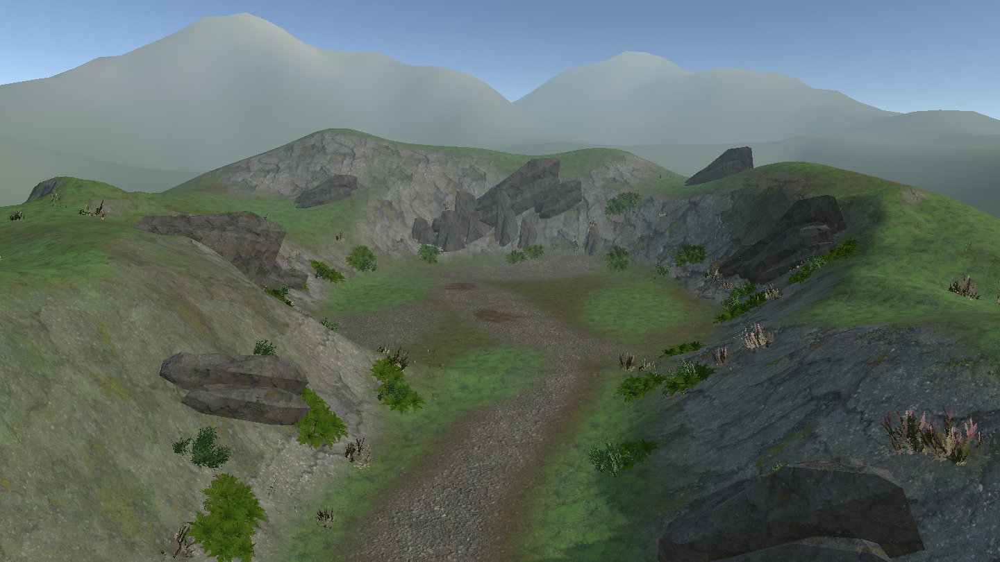
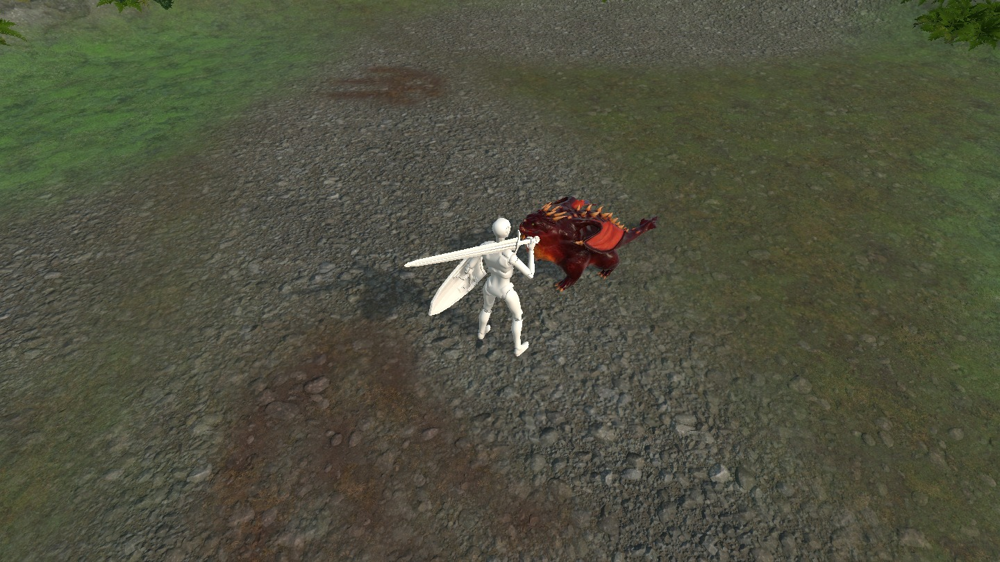

# 드래곤 사냥터 지형 테스트

2026-11-18 · Unity 6000.3.10f1 · [TerrainTestScene 열기](../NetmarbleNeo/Assets/Scenes/TerrainTestScene.unity)

남쪽의 좁은 골짜기를 따라 걸으면 북쪽 바위턱 아래로 시야가 열리고 전투 공터에 도착한다. 씬의 기본 카메라는 진입로에서 공터를 바라본다. Unity에서 지형을 수정하려면 Hierarchy의 `Dragon Valley Terrain`을 선택한다. 입구와 공터 중심은 `Hunting Ground Markers` 아래에 있다.

## 샘플에서 사용한 자산

분석한 [TerrainSampleAssets](../NetmarbleNeo/Assets/TerrainSampleAssets)는 원본 파일 244개, 약 1,942MiB다. 아래 용량과 해상도는 프로젝트에 임포트된 원본 기준이다. 실기기의 메모리나 빌드 용량은 별도로 측정해야 한다.

| 자산 | 샘플 구성 | 이 씬에서의 쓰임 |
| --- | --- | --- |
| 높이맵과 브러시 | 높이맵 44장과 대응하는 브러시 44개. 높이맵은 128²~4096² | `Ridge03`과 `Canyon03`의 높낮이를 양쪽 사면에 혼합했다. 길과 공터는 따로 평탄화해 협곡의 굴곡이 전투 동선을 가로지르지 않게 했다. |
| 지표면 | Terrain Layer 16종, 2048² 텍스처 48장. 각 레이어는 색·노멀·마스크 세 장을 참조 | `Grass_Moss`, `Soil_Rocks`, `Pebbles_C`, `Rock` 네 종류를 선택했다. 씬 전용 레이어에서 타일 크기와 색을 조정하고 샘플 텍스처를 공유한다. |
| 식생 | 풀·관목·양치류·헤더 등 메시와 프리팹 각 20종, 식생 텍스처 31장(1024²), 재질 8개 | 마른 풀과 헤더는 양지에, 양치류와 녹색 관목은 비탈 아래에 모았다. 양치류 7포기와 녹색 관목 5포기를 각각 한 메시로 묶었다. 식생은 URP 알파 컷아웃 재질을 공유하며 충돌체와 실시간 그림자 투사를 생략했다. |
| 암석과 원경 | 샘플에 암석 표면 텍스처가 있고, 제공되는 개별 장식 메시는 모두 식생이다. | 판상 암석 메시 3종을 제작해 샘플 텍스처를 입혔다. 바위턱 18개와 공터 뒤의 솟은 바위 6개가 방향을 알려준다. 바깥 능선은 충돌체 없는 별도 배경 메시다. |

## 동선과 전투 가독성

- **진입로**는 월드 좌표 `(0, -40)`에서 출발해 왼쪽으로 휘었다가 공터 중심 `(5, 12)`에 도착한다. 좌표는 X·Z 기준이다. 중심선을 따라 이동한 길이는 55.20m다. 밝은 자갈을 길 안쪽에, 이끼와 어두운 흙을 가장자리에 칠해 표지판 없이도 진행 방향을 읽을 수 있게 했다.
- **공터**는 드래곤 감지 거리 10m와 양측 기본 공격 거리 2.5m를 기준으로 최소 반경 13m를 평탄하게 확보했다. 공터 안의 자갈 띠와 발톱 자국은 지면 페인팅이다. 높이와 충돌에는 영향을 주지 않는다.
- **씬 구성**은 112×112m Unity Terrain 하나, 257×257 높이맵, 256×256 지면 혼합 맵, 표면 레이어 4개다. TerrainCollider는 표시 지형과 같은 데이터를 사용한다. 바닥의 Rendering Layer Mask는 기본 레이어와 기존 공격 범위 데칼 수신 비트를 합한 129다.

## 에디터 검증

씬을 저장한 뒤 다시 열어 검사했다. 플레이어 프리팹의 충돌 캡슐은 높이 2m, 반경 0.5m, 허용 경사 45°다.

| 검사 | 결과 |
| --- | --- |
| 진입로에서 중심선과 좌우 1.5m·3m를 1m 간격으로 검사 | 205/205 지점에서 바닥 검출. 최대 경사 13.18°, 캡슐을 막는 장식 0건 |
| 공터 중심 반경 13m를 1m 격자로 검사 | 529/529 지점에서 바닥 검출. 높이 1.040m, 최대 경사 0.00°, 캡슐을 막는 장식 0건 |
| 플레이어와 같은 설정의 CharacterController로 입구부터 공터 중심까지 연속 이동 | 에디터 물리 검사 520스텝에서 55.20m 이동. 경로 이탈이나 바닥 이탈 없이 도착 |
| 메시·재질·지형 레이어·충돌체 참조 | 누락 0건. 메시 렌더러 340개가 고유 메시 13개와 재질 7개를 공유한다. 충돌체는 지형 1개와 바위 24개다. |

아래 이미지는 기존 플레이어·드래곤 프리팹을 공터에 임시 배치해 Unity에서 촬영했다. 기존 추적 카메라의 시야각 60°, 거리 5m, 하향 각도 약 41.7°를 적용했다. 저장된 씬에는 지형과 장식, 배치 기준점이 들어 있다. 실제 전투 조작, 모바일 빌드와 실기기 프레임은 이번 검증 범위 밖이다.

