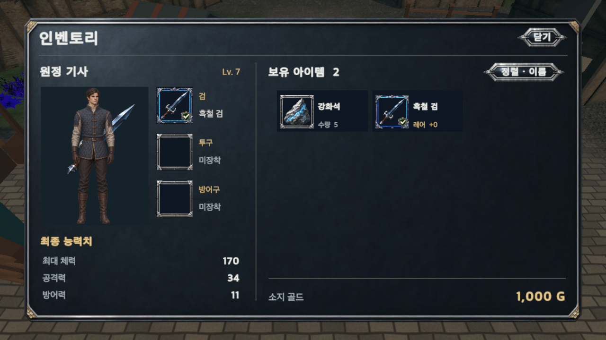

# Unity에서 UI 배치 편집하기

Project 창의 [Assets/Resources/UI](../NetmarbleNeo/Assets/Resources/UI)에서 프리팹을 더블클릭한다. Prefab Mode의 Hierarchy에서 옮길 요소를 선택하고 Rect Tool(T)로 움직이거나 Inspector의 Rect Transform에서 위치와 크기를 입력한 뒤 저장한다. 필드에 들어가거나 해당 창을 열면 저장한 배치를 확인할 수 있다.

| 바꿀 부분 | 열 프리팹과 편집 위치 |
| --- | --- |
| 메인 HUD | [ExpeditionHUD](../NetmarbleNeo/Assets/Resources/UI/HUD/ExpeditionHUD.prefab)의 `Safe Area/Safe Stage`. `Field/OpenInventory`는 인벤토리 버튼, `Field/MoveBetweenMaps`는 출입구 이동 버튼, `Field/RecallToVillage`는 사냥터 어디서든 쓰는 마을 귀환 버튼이다. `Knight Status`에서 캐릭터 상태 표시를 편집한다. 파티 버튼과 추적 목표 영역의 화면상 배치도 여기서 조절한다. |
| 인벤토리와 장비 | [InventoryWindow](../NetmarbleNeo/Assets/Resources/UI/Inventory/InventoryWindow.prefab)의 루트는 창 전체, `Data/Bag Scroll`은 가방 영역이다. 그 안의 `Viewport/Content/Item Card Template`에서 첫 카드 위치·크기와 하위 아이콘·텍스트를 편집한다. `Content`의 `UiRepeatingList`에서 열 수와 가로·세로 간격을 설정한다. [장비 상세와 강화 확인](../NetmarbleNeo/Assets/Resources/UI/Inventory)도 개별 프리팹이다. |
| 의뢰·NPC 대화 | [Quests](../NetmarbleNeo/Assets/Resources/UI/Quests)의 `QuestJournal`, `NpcDialogue`, `TrackedObjective`에서 각 화면과 반복 행을 편집한다. 대장장이 전용 `NpcDialogue/ForgeButton`이 장비 목록을 열고, 장비를 고르면 `EnhanceConfirmation`이 비용과 확률을 표시한다. |
| 퀘스트 자동 진행 | [AutoQuestControls](../NetmarbleNeo/Assets/Resources/UI/Quests/AutoQuestControls.prefab)의 `FieldDock`에서 일반 HUD 위치를, `InventoryDock`에서 자동 진행이 연 인벤토리·NPC 대화창 위의 버튼 위치를 조절한다. 버튼의 `Status`가 현재 수행 중인 행동을 표시한다. |
| 파티와 보스 | [Party](../NetmarbleNeo/Assets/Resources/UI/Party)와 [Boss](../NetmarbleNeo/Assets/Resources/UI/Boss)에서 초대, 명단, 보스 입장, 관전, 부활, 승리 창을 편집한다. `Roster`의 `Member1`~`Member4`는 자리, `MemberRow`는 각 자리에서 공유하는 행이다. |
| 전투 버튼과 머리 위 표시 | [Combat](../NetmarbleNeo/Assets/Resources/UI/Combat)의 `AutoCombatButton`은 자동 전투 버튼, `SpinningSlashButton`은 회전 베기 버튼이다. 각 프리팹 루트의 Rect Transform에서 위치와 크기를 바꾼다. 같은 폴더의 플레이어·몬스터·보스 체력바 위치는 캐릭터 머리를 기준으로 한 화면 오프셋이다. 마을 NPC 이름표는 [VillageNameplate](../NetmarbleNeo/Assets/Resources/UI/HUD/VillageNameplate.prefab)에서 조절한다. |
| 로그인·로딩 | [Login Scene](<../NetmarbleNeo/Assets/Scenes/Login Scene.unity>)에서 자동 접속 배경·타이틀·상태 문구와 **새 게임 시작** 버튼을 편집한다. 이 버튼은 서버가 기기에 저장된 게스트 토큰을 무효로 확인했을 때 표시된다. [WorldLoadingScreen](../NetmarbleNeo/Assets/Resources/UI/Loading/WorldLoadingScreen.prefab)에서 목적지 그림·하단 안내·진행 바를 편집한다. |

메인 HUD는 안전 영역에 맞춰 전체 배율을 조절한다. 늘어나는 앵커를 쓰는 요소는 Inspector의 Left·Right·Top·Bottom 여백으로 크기를 조절한다. 인벤토리 항목 수, 체력 게이지의 채움, 머리 위 표시의 캐릭터 추적, 로딩 진행률은 게임 데이터에 따라 갱신된다. 버튼과 텍스트는 프리팹 내부 경로로 연결하므로 위치와 크기를 편집할 때 기존 오브젝트 이름과 부모를 유지한다.

## iPhone 15 가로 화면

로그인·로딩·전투 Canvas의 기준 해상도는 2556×1179다. 로그인과 로딩 일러스트는 화면 끝까지 채우고, 게임 조작 버튼과 안내 문구는 기기가 보고한 `Screen.safeArea` 안에 배치한다. 실제 전투 버튼과 조이스틱의 부모는 씬 Canvas의 `Safe Controls`다. 인벤토리·의뢰·파티·보스 창은 `ExpeditionHUD/Safe Area/Safe Stage`의 기존 1280×720 편집 좌표를 공유하고, 안전 영역 안에 들어오는 배율로 함께 조정된다. [안전 영역 적용](../NetmarbleNeo/Assets/Scripts/UI/ScreenSafeArea.cs) · [iPhone 15 디스플레이 사양](https://support.apple.com/ko-kr/111831)

퀘스트 수첩과 NPC 대화에는 서버에서 수락 가능하다고 판정한 의뢰와 이미 진행 중인 의뢰가 나온다. 보고·납품 대기는 보상을 받을 때까지 표시한다. 보상을 받으면 해당 의뢰가 목록에서 사라지고, HUD는 다음 유효한 의뢰를 표시한다. [퀘스트 표시 조건](../NetmarbleNeo/Assets/Scripts/UI/Expedition/ExpeditionQuests.cs)

Unity Play Mode에서 2556×1179 화면과 좌우 177px·하단 63px의 테스트 안전 여백을 사용해 로딩·전투·의뢰 수첩·인벤토리를 확인했다. 조이스틱과 전투 버튼 5개의 터치 위치, 안전 여백을 바꿨을 때 HUD의 재배치를 확인했다. 자동 접속 화면도 별도 임시 계정으로 두 번 실행했다. 두 실행 모두 버튼과 입력창이 0개였고, 처음에는 게스트 계정을 생성한 뒤 다음 실행에서 같은 계정을 복원해 월드 씬으로 전환했다. 신규·수락·보고 대기·보상 수령 상태를 담은 서버 진행 데이터로 수첩·NPC 대화·HUD의 표시 사례 10개를 확인했다. [로그인 화면](verification/ui-prefabs/iphone15-login.jpg) · [의뢰 수첩 화면](verification/ui-prefabs/iphone15-journal.jpg)

## 2026-11-21 플레이 모드 검증

Unity 6000.3.10f1에서 UI 프리팹 28개를 임포트하고 누락된 스크립트를 검사했다. 프로젝트 복사본에서 14개 요소의 Rect Transform을 변경해 저장한 후 플레이 모드 인스턴스와 비교했다. 아래 값은 검증에 사용한 값이다.

| 요소 | 변경한 위치 | 변경한 크기 | 플레이 모드 결과 |
| --- | --- | --- | --- |
| HUD 인벤토리 버튼 | (979, −66) | 213 × 73 | 월드 세션에 접속한 뒤 일치 |
| 인벤토리 아이템 카드 | (18, −5) | 192 × 88 | 두 아이템에 적용. 다음 카드의 X 간격 201 확인 |
| 의뢰 목록 행 | (9, −7) | 380 × 83 | 목록 전환 후 위치·크기와 다음 행 간격 96 확인 |
| 보스 입장 버튼 | (308, −246) | 215 × 65 | 보스 입장 창에서 일치 |
| 마을 경비대장 이름표 | (0.4, 2.75) | 8 × 1.35 | NPC 아래 월드 공간 위치와 크기 일치 |

나머지 비교 대상은 게스트 버튼, 회전 베기 버튼, 플레이어 머리 위 체력바, 로딩 안내 영역, 파티 초대 수락 버튼, 두 번째 파티원 자리와 이름, 보스 관전 전환 버튼, 승리 창 확인 버튼이다.

로컬 전투 씬에서 스킬 입력·쿨다운과 체력바 추적을 확인했다. 월드 세션에서는 로컬 호스트와 검증용 장비·퀘스트·파티 데이터로 인벤토리 정렬, 장비·재료 상세, 강화 확인·취소, 의뢰 선택·추적, 파티 초대·입장 준비, 보스 승리 창을 확인했다. 마을·사냥터·보스방의 로딩 그림과 문구, 진행 바도 확인했다. 검증 환경은 macOS Unity 에디터였다.

