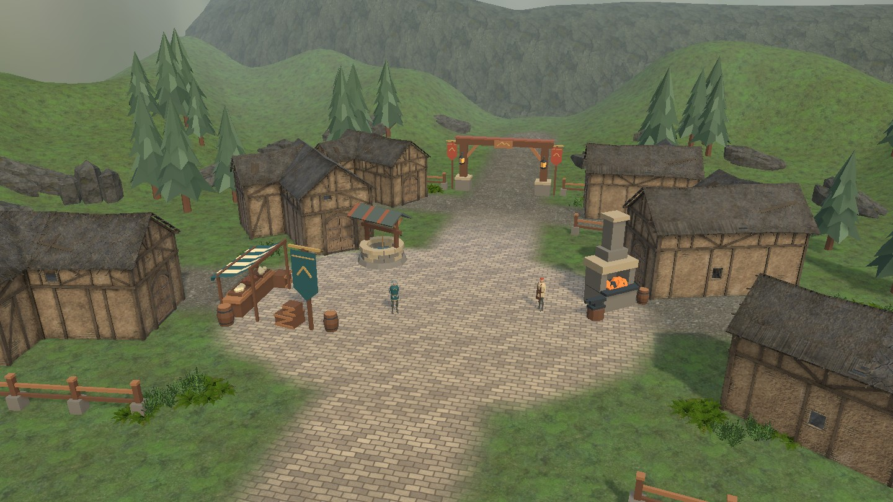
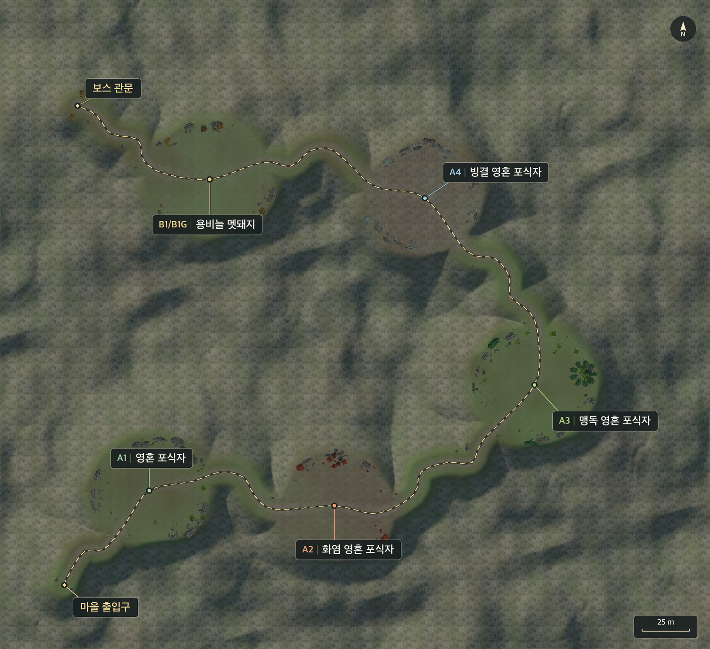
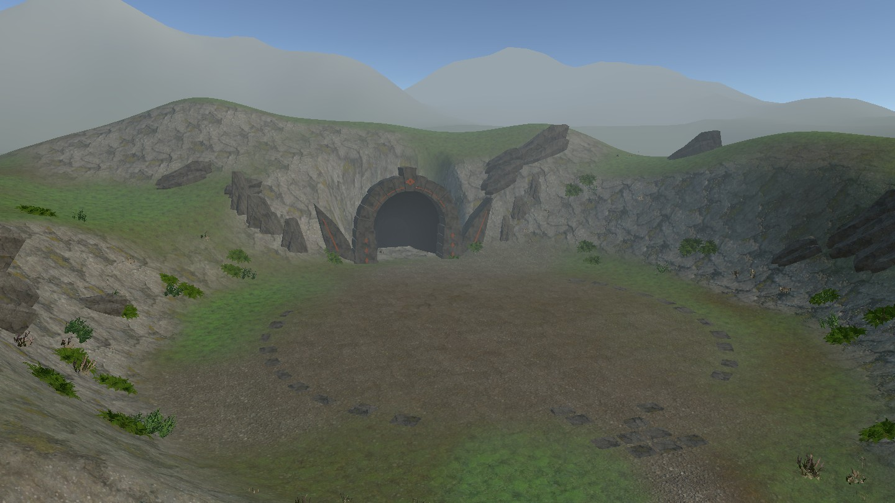

# 용이 잠든 능선 · 마을, 사냥 필드, 보스방

2026-11-21 · Unity 6000.3.10f1

로그인 후 첫 지역은 마을이다. 마을 북문과 사냥터 입구에 다가가면 목적지 이동 버튼이 나타난다. 일반 사냥터에서는 인벤토리 아래의 **마을 귀환**을 눌러 전투 중에도 바로 마을로 돌아갈 수 있다. 자동 전투와 의뢰 자동 진행은 꺼지고, 마을의 사냥터 귀환 지점에 도착한다. 보스 입장 준비 중에는 귀환 버튼이 숨겨진다. 첫 보스 도전은 사냥터 끝 관문에서 시작하며, 발견 이후에는 마을에서 재도전할 수 있다. 파티의 보스 승리·전멸과 솔로 사망은 마을 부활 지점으로 연결된다. 살아서 보스전을 떠나면 입장에 이용한 지역으로 돌아간다.

목적지 일러스트는 실제 맵 로딩과 동시에 최소 4초 동안 표시한다. 이동 문구 위에는 이동할 때마다 팁을 하나씩 보여주며, 10개를 모두 보여주면 처음으로 돌아간다. 팁의 문구와 순서는 [로딩 화면 프리팹](../NetmarbleNeo/Assets/Resources/UI/Loading/WorldLoadingScreen.prefab)의 `World Loading Screen → Tips`에서 편집한다.

| 도착 지역 | 로딩 일러스트 | 반복 재생 음악 |
|---|---|---|
| 마을 `village` | [북문과 광장](../NetmarbleNeo/Assets/Resources/WorldLoading/Village.jpg) | [VillageCamp.wav](<../NetmarbleNeo/Assets/Audio/AI Generated/VillageCamp.wav>) |
| 사냥터 `HuntingField` | [바위 능선](../NetmarbleNeo/Assets/Resources/WorldLoading/HuntingField.jpg) | [World Map.wav](<../NetmarbleNeo/Assets/Audio/World Map.wav>) |
| 보스방 `BossRoom` | [석문을 지키는 용](../NetmarbleNeo/Assets/Resources/WorldLoading/BossRoom.jpg) | [Final Boss Battle.wav](<../NetmarbleNeo/Assets/Audio/Final Boss Battle.wav>) |

`WorldSession`은 접속·플레이어·카메라·HUD를 유지한다. 서버는 지역 지형을 먼저 준비하고 입장 요청자의 위치와 상태를 검사한다. 클라이언트는 자기 캐릭터가 속한 지역만 추가 로드한다. 동시에 도전한 두 파티는 별도 위치와 관찰자 목록을 사용한다. 씬을 열어 Hierarchy의 입장·복귀·스폰 마커를 옮기면 런타임도 해당 위치를 읽는다.

## 지역 이동 검증

2026-11-23 Unity 6000.3.10f1의 격리 Play Mode에서 실제 세 맵을 로드하고 테스트 계정을 메모리에서 복원한 NGO 호스트로 **마을 귀환**을 확인했다. 사냥터 출입구에서 22.7m 떨어지자 기존 포털 버튼은 숨겨지고 귀환 버튼은 표시됐다. 자동 전투와 의뢰 자동 진행을 모두 켜고 HUD 버튼의 클릭 이벤트를 호출하니 서버 지역 이동은 한 번 발생했고, 마을 도착 지점까지의 거리는 1.08m(캐릭터 높이 포함)였다. 두 자동 기능이 꺼지고 귀환 버튼이 사라졌다. 마을에서 중복 요청, 필드 재방문 후 이전 방문의 요청, 보스방·필드 사망 상태의 요청은 모두 서버가 거절했다. iPhone 화면을 직접 터치하거나 별도 단말 간 패킷을 전송하는 검사는 이번 실행에 포함하지 않았다.

2026-11-21 macOS 게임 서버 한 개와 별도 클라이언트 두 개로 게스트 로그인부터 마을 복귀까지 실행했다. A만 북문의 이동 버튼을 누르면 B는 마을에 남았고, 출입구에 서서 기다리는 동안에는 누구도 이동하지 않았다. 두 클라이언트에서 도착지 그림, 실제 재생 중인 음악, 현재 로드된 지역을 확인했다. [사냥터 입구의 마을 이동 버튼](verification/world-maps/field-return-button.jpg)

동시 솔로 도전에서는 서로 다른 방과 보스가 생성됐다. 파티 도전에서는 사망자의 카메라와 이름표가 생존한 동료를 가리켰고, 승리와 전멸 양쪽에서 두 캐릭터가 살아서 마을로 돌아왔다. 이동 자체는 실제 HUD와 네트워크 경로를 사용했고, 테스트 서버에서 관문 접근 위치·퀘스트 진행·사망·처치를 재현했다. 모바일 실기기의 터치와 로딩 시간은 별도 검증 항목이다. [실행 결과](verification/world-maps/travel.json)

## 마을

[village.unity](../NetmarbleNeo/Assets/Scenes/village.unity) · 지형 112×112m

남쪽 도착 지점에서 포장된 광장으로 들어오면 왼쪽에 경비대장과 보급 천막, 오른쪽에 대장장이와 화덕이 보인다. 북쪽 들문 너머가 사냥 필드 방면이다. 여섯 채의 건물은 지정한 [Medieval_Building.fbx](../NetmarbleNeo/Assets/Prefabs/Building/Medieval_Building.fbx)를 사용했다. 두 NPC는 플레이어 모델의 검과 방패를 숨기고 자세와 복식을 달리했다. 위치는 `Village/Inhabitants`, 도착·부활·NPC 접근·필드 출구 기준점은 `Village/Placement markers`에서 조정할 수 있다.

[경비대장과 플레이어의 크기 비교](verification/world-maps/village-npc.jpg)

## 일반 몬스터 사냥 필드

[HuntingField.unity](../NetmarbleNeo/Assets/Scenes/HuntingField.unity) · 지형 376×344m · 마을 출입구에서 다섯 공터의 중심을 지나는 보스 관문까지 약 662m

바위 능선을 따라 굽이치는 좁은 길이 다섯 공터를 잇는다. 입구에서는 다음 공터의 바위 또는 식생이 먼저 보이고, 공터 안쪽에서 전투 공간이 열린다. 각 구역의 기준점은 `Hunting Zones → 구역 이름 → Monster Spawns`에 네 개씩 있다. `Travel Markers`에서 마을 복귀·필드 도착·보스 관문 위치를 찾을 수 있다.

| 권장 순서 | 몬스터 | 공터 설계 크기 | 식별 지형 |
|---|---|---|---|
| A1 · Lv.1 | 영혼 포식자 드래곤 | 62×56m | 두 선돌에 얹힌 판석 |
| A2 · Lv.3 | 화염의 영혼 포식자 드래곤 | 64×58m | 붉은 굴뚝 모양의 암주 |
| A3 · Lv.5 | 맹독의 영혼 포식자 드래곤 | 64×62m | 양치류와 뱀처럼 휘감긴 녹색 바위 |
| A4 · Lv.10 | 빙결의 영혼 포식자 드래곤 | 62×58m | 볏처럼 솟은 푸른 석영 |
| B1 / B1G · Lv.15 | 일반·황금 용비늘 멧돼지 | 68×62m | 엄니 한 쌍과 마른 풀밭 |

아래 안내도는 Unity에서 수직으로 촬영한 필드에 검증 경로를 표시한 것이다. 점선은 다섯 구역을 확인할 수 있는 동선이다. [몬스터 기획표](../outputs/01a1e7d3-dac7-7681-a8af-d8ddcca9549d/사냥터_몬스터_데이터.xlsx)

검증용으로 각 공터에 실제 프리팹 네 마리를 임시 배치했다. 스폰 지점의 최소 간격은 16.01m다. 각 개체가 원점에서 5m 움직이는 범위 안을 1m 격자로 검사했다. 플레이어의 기본 쿼터뷰에서도 드래곤과 바닥의 가독성을 확인했다. [쿼터뷰 크기 비교](verification/world-maps/field-game-camera.jpg) · [멧돼지 네 마리 배치](verification/world-maps/field-boars.jpg)

## 보스방

[BossRoom.unity](../NetmarbleNeo/Assets/Scenes/BossRoom.unity) · 지형 184.8×184.8m

기존 [TerrainTestScene](TERRAIN_TEST_SCENE.md)의 지형 데이터를 독립 복제해 굽은 골짜기와 바위턱을 확장했다. 공터 가장자리에는 낡은 판석을 놓고, 보스 뒤에는 청동 상감 석문을 세웠다. `Boss Room Markers` 아래에 도착·출구·전장 중심·파티원 네 자리·보스 위치가 있다.

[보스 1마리와 플레이어 4명을 임시 배치한 전경](verification/world-maps/boss-party.jpg)

## 배치 검증

저장한 각 씬을 다시 열고 실제 플레이어 프리팹과 같은 CharacterController(높이 2m, 반경 0.5m)로 대표 경로를 연속 이동했다. 필드와 보스방에서는 경로 중심선 좌우 2.5m에 캡슐 한 개가 지나갈 공간과 바닥이 있는지도 검사했다.

| 검사 | 마을 | 필드 | 보스방 |
|---|---:|---:|---:|
| 연속 이동 길이 | 43.28m | 661.69m | 99.08m |
| 통로 양옆 바닥·충돌 검사 | — | 1,474 / 1,474 | 224 / 224 |
| 스폰 주변 / 전투 공터 바닥·충돌 검사 | — | 1,620 / 1,620 | 1,257 / 1,257 |
| 기본 쿼터뷰 방향으로 충돌체가 시야를 막은 지점 | 0 / 39 | 0 / 564 | 0 / 86 |

보스 공터는 중심 반경 20m를 검사했다. 원본 프로젝트에 반영한 뒤 세 씬을 미리보기로 다시 열었다. Unity가 확인한 에셋 의존성은 마을 111개, 필드 50개, 보스방 56개였으며 메시·재질·스크립트 참조 누락은 0건이었다. 검증은 macOS Unity 에디터에서 수행했다. 몬스터의 실제 스폰·배회, 네트워크 이동, 모바일 실기기 프레임은 이번 측정 범위 밖이다. [에디터 측정값](verification/world-maps/placement-checks.json)
